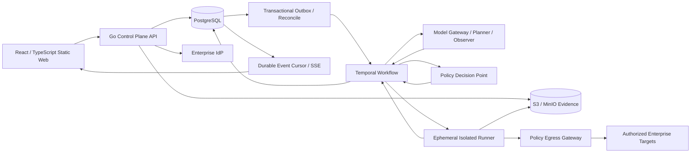

# 新一代授权安全验证平台设计

本文描述完整平台的目标架构。草稿命令与企业身份已完成本地验收，实际合同见 [草稿设计](../archive/2026-10/10-12-p0-command-foundation/design.md) 和 [身份设计](../archive/2026-10/10-12-p0-identity-access/design.md)。第三个 [授权与资产切片](../10-12-p0-authorization-assets/design.md) 已完成本地验收；Temporal、Runner、审批、证据及完整领域闭环仍属后续实施，不能由本图推定已完成。

## 架构选择

采用 Go 模块化控制面与隔离执行面。控制面拥有业务真相、策略和审计；Runner 执行带时限的已批准 Action。保留 ARTEX 双图、过程 trace、共享 todo、任务历史和发现闭环，把运行控制移到持久化工作流。

## 模块边界

| 模块                | 负责内容                                                    | 不能负责的内容     |
| ------------------- | ----------------------------------------------------------- | ------------------ |
| Identity & Access   | V1 OIDC、成员、角色、项目/资产 ABAC；P3 按需增加 SAML、SCIM | 直接决定网络连接   |
| Authorization       | 授权书版本、资产规范化、操作等级、审批和策略决定            | 调用外部工具       |
| Asset & Knowledge   | 资产、服务、端点、资产图和探索图元数据                      | Runner 生命周期    |
| Workflow            | Agent 回合、Action 生命周期、lease、重试、取消与人工介入    | 永久保存工具输出   |
| Runner Control      | 签发一次性执行令牌、选择隔离池、收集心跳                    | 持有业务状态真相   |
| Evidence & Findings | 证据 manifest、哈希、访问记录、发现、复测和报告             | 修改原始证据       |
| Model Gateway       | 模型路由、结构化输出验证、成本和版本记录                    | 覆盖策略决定       |
| Audit & Eventing    | append-only 审计、outbox、SSE 投影和合规导出                | 作为工作流队列真相 |

模块首先在同一个 Go 仓库中通过明确接口实现。API 与 Temporal worker 可由同一代码库作为两个部署单元运行；Runner、浏览器 Runner、egress gateway 和 Temporal 独立部署，分别承担隔离、伸缩和恢复职责。PostgreSQL 是授权、Action/Attempt、lease、证据关联、业务事件与查询投影的权威存储；Temporal 是工作流进度、timer、signal 与 Activity 编排的持久引擎。两者通过稳定 ID、幂等命令和 reconcile 协同，不维护可各自修改的第二份动作权威状态。数据库关系图只用于业务查询。

## ARTEX 继承与领域模型

领域链条为 `Project -> AuthorizationLetterVersion -> Task/Run -> PlanRevision/Intent/Action -> Attempt/Observation -> Evidence -> Finding -> Retest/Report`。全局 `Asset/AssetRelation` 存储跨任务资产事实，任务探索节点和 `Anchor` 关联资产；所有观测保留来源、时间、有效期和对应 Action。

- 保留 ARTEX 的全局资产图与任务探索图，首版用 PostgreSQL 节点/边/锚点表，不增加图数据库。Finding 是权威业务对象，图中的 finding node 是事务 outbox 驱动的投影，避免两个对象各自修改。
- Task 保留模板、分类、目标、范围、资产关联和历史。引用旧任务资产/事实时记录来源与过期条件；旧授权、审批和凭据不继承。全局资产图属于首版，跨任务自动语义推理和向量记忆属于 P3。
- PlanRevision 保留 Planner 待办、依赖、优先级、阻塞原因和关闭理由；todo 必须落库，不能随模型 provider 重建而丢失。Worker trace 按 task/intent/run 查询，模型只接收带引用的摘要和必要分页，不把所有 transcript 合并成无限上下文。
- 会话历史区分模型叙述、结构化事实、计划提案、工具请求和真实执行事件。侧问默认只读；需要执行的消息必须生成新的 Action，继续经过相同校验。
- 覆盖以授权范围版本和检查维度为分母，分别记录未测、完成、失败、拒绝、不适用、结果未知。发现新资产只更新知识；扩大评估范围需要新授权书版本。

六个工作区为项目与范围、任务、发现与复测、证据、审批、平台设置。任务详情聚合计划/todo、双图、时间线、会话、覆盖和费用；图表采用筛选、按需展开和分页。首版站内通知由 outbox 驱动，外部通知、完整归档恢复和资产同步后置到 P3；恢复历史包不会自动恢复执行。

## 前端工作台合同

shadcn/ui 已作为获批首个切片的组件和设计系统基础落地。ARTEX 已使用 shadcn/Radix，不能把重新采用同一组件视为能力提升。新平台将基础控件组合为稳定的业务组件：TaskSummary、ActionTimeline、FindingTable、EvidenceViewer、ScopeEditor 和 ApprovalPanel。各组件共享领域 ID、版本、权限与错误模型，不各自实现一套状态语义。

| 分析员可观察的结果                     | 前后端共同遵守的契约                                                                                                                                                                                                                                                                                             |
| -------------------------------------- | ---------------------------------------------------------------------------------------------------------------------------------------------------------------------------------------------------------------------------------------------------------------------------------------------------------------- |
| 从任务概况判断进度、阻塞、缺口与下一步 | 分开展示任务聚合状态、真实执行/Attempt、证据状态；预算、待审批、在途和 unknown 可下钻。主要内容为计划与执行，会话使用侧栏，详情按操作上下文组织。                                                                                                                                                                |
| 跨入口内容一致，大列表完整可查         | 稳定 row ID/版本；服务端筛选/排序/分页及总量或明确数量未知，截断显式提示。筛选写 URL，返回恢复列设置/位置；区分当前页选择、指定 ID 和全部匹配结果，服务端重验批量权限。导出绑定明确查询/版本快照。                                                                                                               |
| 双图解释事实与结论的来源               | 共享实体引用，区分观察、计划、执行和结论；按需子图/展开、隐藏数量、来源跳转和返回。增量更新保留视口/选中节点，提供等价列表路径。React Flow 优先用于任务 DAG/谱系与适度资产子图，超大网络图另行压测选型。                                                                                                         |
| 时间线说明模型提案与真实执行的差别     | 按 run/action/attempt 聚合分页，显示事件序号、发生/记录时间及迟到事件。暂停/取消区分请求、出口确认和 Runner 确认，沿用停止中/在途/未知合同。                                                                                                                                                                     |
| 在证据工作台完成独立复核               | 关联执行与来源，显示采集 full/partial/unavailable、hash 校验、脱敏/访问限制与缺失原因；大对象按需加载。不可信 HTTP/HTML 使用转义文本或隔离预览，禁止执行目标脚本或自动访问响应中的远端资源。报告显示冻结版本/过期，CAS 冲突保留用户输入。                                                                        |
| 刷新、断线、超时后清楚数据与命令状态   | 统一 loading/empty/error/stale/reconnecting 与最后同步时间，cursor 回补后刷新权威缓存；关键命令显示提交中/已受理/执行中/确认完成，客户端在发送前生成命令 ID/幂等键，超时按该 ID 查询。Go 在同事务持久化受理、业务变更及 outbox，相同键不同参数拒绝；结果查询重验权限，未查到时不误报执行失败。草稿恢复排除秘密。 |

UI 统一中文术语、严重程度与执行状态色、深浅色主题、紧凑/标准密度、可见焦点、对比度与键盘路径；颜色不能成为唯一状态表达。默认围绕桌面分析工作，窄屏仍可完成审批、查看状态与暂停。shadcn primitives 提供基础可访问性，组装后的表格/图/弹窗仍需实际键盘、读屏和焦点恢复验证。R13/A11–A12 将这些契约纳入 V1，数值性能门槛在取得可比较基线后确定。

## 核心合同

### 授权书

`AuthorizationLetter` 是运行前置条件，采用不可修改、可 supersede 的版本记录。它包含：项目、授权依据与联系人、允许资产/CIDR/域名、解析与重定向规则、操作上限、工具和参数约束、速率限制、时窗、凭据类别、审批规则、策略包版本和过期时间。每个 Run 固定一个激活版本和目标快照，同时叠加当前紧急 deny、授权/能力撤销和平台硬上限；固定旧版本不能豁免后来收紧的规则。版本撤销后旧 Run 停止新执行。范围变化须创建新版本并重新计划，审批不能修改授权书。

### 行动 Action

Agent 只能请求结构化 `Action`：`task_id`、`intent_id`、`tool_id`、规范化目标、已声明参数、幂等键、期限和期望证据类型。模型输出必须通过 schema 校验，且不拥有操作等级的判定权。服务端 `ToolCapability` 目录固定适配器的参数 schema、允许协议/端口/方法、速率/并发、凭据模式、重放属性和最大操作等级；控制面依次校验授权书、能力目录、目标解析、速率/时窗和审批令牌，成功后才创建可领取的执行租约。

审批保存真实 actor、角色/项目权限快照、Action hash、参数摘要、目标快照、适配器版本/镜像 digest、授权与策略版本和 TTL；修改任一绑定字段均使旧批准失效。审批及领取时都重验当前权限/范围/撤销，不以进程内 channel 作为恢复真相。所有实际内层工具调用经同一 admission，不能以 wrapper 名称、schema 隐藏、skill unlock 或 MCP discovery 替代真实能力校验。

### 证据包

每个包由 manifest 和内容对象组成。manifest 记录 task/run、action_id、attempt_id、runner_id、授权版本、目标快照、工具/镜像 digest、策略决定、开始/结束时间、对象 SHA-256、脱敏配置、证据链上一个 hash，以及声明采集范围内的 full/partial/unavailable 覆盖及缺失原因。对象储存在启用版本化和 Object Lock 的 S3/MinIO bucket；数据库只保存引用与索引，访问、导出和保留策略变化写入审计流。证据在配置保留期或法律保全期内不可改写，期满后通过经审计的对象删除或数据密钥销毁处理。

哈希用于保存后完整性，Runner 签名用于来源身份与抵赖检测，均不单独证明被攻陷 Runner 的观察真实或采集完整。要求验证证据的 Action 若采集不可用则停止后续验证；覆盖不足不能产生 verified finding。策略、关键审计或必需证据采集/持久化故障时停止新外部动作，普通 UI/指标故障不必阻断运行。

### 发现与复测

`Finding` 必须引用至少一份 Evidence Package 和关联 Action；候选、机器验证、人工确认与处置状态分开记录。升为 verified 由独立验证器确认操作在授权上限内、证据覆盖足够、来源可复核、环境与时间窗口明确；模型 confidence、工具退出码或 Worker 正常返回均不足以确认。`Retest` 在独立 workflow 中锁定 finding、目标与复测上下文，且同一 finding 同时只允许一个活跃复测；只有完成且明确 `fixed` 改变 finding 状态，`reproduced`、`inconclusive` 只追加历史。

`ReportVersion` 固定所引用的 finding_version、evidence_version、授权/范围版本、覆盖快照与模板版本。生成时冻结索引和正文，沿用 ARTEX 证据版本/CAS 与独立副本做法；导出不会混入后续编辑。发现或证据变更时旧报告标记过期，可继续查看原版本并显式重生成。Markdown/HTML 和 manifest 的这个版本合同属于 V1，复杂排版/PDF 才属于 P3。

## 持久化 Agent 工作流

任务包括 `draft`、`planned`、`queued`、`running`、`paused`、`waiting_approval`、`completed`、`failed`、`cancelled` 状态；暂停/审批完成后可以继续 running。Action 主路径为 `proposed -> authorized -> queued -> leased -> running -> observed -> succeeded`，需复核时从 proposed 进入持久 `awaiting_approval`，批准后重新校验再转 authorized；另有 failed/denied/expired/cancelled 分支和 outcome_unknown 待协调状态。单个 Action 等待审批不冻结其他允许执行的 Action；仅当无可运行工作且尚有待审批项时，任务投影为 waiting_approval。

Attempt 单独记录 `leased -> in_flight -> observed -> succeeded | failed`；仅在确认尚未发出或已停止且结果明确时可 cancelled/expired，无法确认的已发请求为 outcome_unknown。Action 根据有效 Attempt 的证据/结果聚合，保留全部历史尝试；未知状态不伪装成 failed/cancelled 后立即重跑。任务终态与覆盖/结论完整性分开：终止调度不等于所有检查成功，终止时仍须展示在途、未知和未覆盖数量及原因。

1. 人创建或启动任务，工作流加载授权书、资产和策略版本。
2. Planner 从只读任务投影、前序活动和证据索引生成结构化 Action 提案。
3. Policy Decision Point 对每个提案默认拒绝，只有完整匹配才授权；审批只能批准仍满足当前授权书与能力目录的 Action，范围变化和首版禁止操作被拒绝。
4. Runner 用单次 jti 领取/兑换执行 lease，再获取短期、绑定 lease/fencing/目标/预算的执行 capability 和凭据。一个多请求 Action 可在 capability 上限内执行多个请求，不重复消费领取 jti；每个目标连接仍经 egress gateway 复核。
5. Runner 以序列化事件回传心跳、摘要、对象引用和结果；控制面在一个事务中写活动、业务变化和 outbox。
6. Planner 仅依据已落库的投影开始下一轮。重复事件用 Action id 和幂等键去重，过期 lease 由工作流恢复或终止。每个 Action 只有一个有效 lease，带单调 fencing generation；网关拒绝旧 generation 的新请求，控制面隔离迟到结果。网络请求不能保证 exactly-once，超时也不能证明请求未生效：网关记录每个 attempt，旧 Runner 终止或隔离后才考虑重派，且只有能力目录标记为可安全重放的适配器才会自动重试。无法确认的 attempt 标为 outcome_unknown。

暂停与取消均先停止新 Action admission/调度，并撤销目标 capability、要求 gateway 停止新目标请求/连接；平台上传/回执通道继续允许。控制状态记录 stop_requested、出口撤销确认和 Runner 停止确认，不能在尚未确认时显示已完全停止；撤销传播延迟以配置上限和 fail-closed 测试验收。取消终止 Runner；暂停按适配器能力保留 checkpoint 或回收 Runner，已发请求只收回执，恢复重新校验授权/策略后续行。已经发出的请求不能保证撤回，界面必须显示在途和结果未知情况。

Planner 设置轮次、时间、Token/费用、请求数和并发预算，以及连续无新证据的停机条件。Observer 输出证据支持程度和未覆盖原因，模型不得自行将无证据推测提升为已确认 Finding。

Temporal 是高自主 V1 的推荐工作流引擎，因为它覆盖长等待、重试、worker 丢失、审批 signal 与取消。Workflow 历史保存引用和小型状态，不写入大段模型对话或证据正文；网络和模型调用位于 Activity，工具 Activity 默认不重试，只有明确可安全重放时配置重试。长期运行用 continue-as-new 控制历史规模，并版本化 Workflow 代码。纯 PostgreSQL lease/outbox 可用于小型受限演示，但本路线不并行实现第二套生产调度器。

DB 写 run/action/approval 与 workflow 命令 outbox 使用同一事务；dispatcher 用稳定 Workflow ID 和命令幂等键启动或 signal，重复投递可安全处理。周期 reconcile 找出 DB 已提交但 Temporal 尚未启动/接收的命令及 orphan execution。Temporal 完成 Activity 也不代表业务证据提交成功，Activity 通过控制面幂等事务确认后才能推进。禁止在 Workflow replay 中直接调用模型或目标工具。

SSE 广播只作唤醒，客户端数据由持久事件表按 cursor/seq 查询；按流串行分配序号并提交，或使用明确的提交水位，不能让后提交的低序号被游标跳过。快照与后续 cursor 一致，查询分页、权限过滤与去重；缓冲溢出立即重查/断开，不能继续跳过缺口。游标超过事件保留窗口则明确返回过期并要求重快照，不声称无限期回放。领域 event 与业务在一个事务中提交，通知 fan-out/渠道投递是可重试消费者。

## 模型与扩展治理

继承 ARTEX 的多协议 profile、健康、重试和 failover 思路。首版每种角色配置主 profile 与获准 fallback，记录 profile/model/prompt/schema 版本、调用费用和切换原因。显式模型链耗尽 hard stop，不偷偷回落全局；cursor 推进绑定 chain revision/CAS，旧请求不能覆盖新配置。provider adapter 使用 typed error 区分 quota、rate limit、auth、transient、context 与 cancelled。流式输出尚未 committed 时才可当次 failover；已交付文本/工具输入后不换模型拼接或重放。结构化输出不完整时重新规划，不直接重放已发出的工具操作。

私有化部署的数据边界包括模型供应商。每个项目明确允许的模型目的地和可发送数据级别；原始凭据、未脱敏证据正文与敏感目标响应默认不发送到外部模型。需要全内网部署时配置本地兼容端点，同一接口仍需通过质量评估；不把“本地模型”视为与外部模型能力等价的事实。

通知目的端点变更不能隐式沿用旧秘密，这是 ARTEX 已有的正确做法；新平台推广到模型、代理和扩展等有凭据的目的端点，要求重新绑定或明确清空秘密，并审计变更。

Prompt/Skill 视为版本化的规划输入；MCP 和自定义工具视为潜在执行能力。V1 仅接入少量固定、经过验证的适配器，不提供任意远端 MCP 或运行时上传执行脚本入口。P3 私有注册表必须声明 manifest、schema、镜像 digest、来源、依赖、网络目的地、最大操作等级和回放属性，仍通过 Policy/Runner 合约。

## 策略与 Runner 安全边界

- 默认拒绝。规则匹配包括项目、授权书版本、工具镜像 digest、目标 canonical form、DNS/IP 解析结果、能力目录派生的操作等级、参数、速率、时窗和审批令牌。
- 首版只允许主动枚举和非破坏性验证。凡主动改变目标业务数据、身份或配置，取得持久驻留、实施破坏性/不可逆利用或可用性影响测试的 Action 一律拒绝；人工审批也不能解锁。只读语义不能由 HTTP 方法或工具名称推断，需审核具体适配器和检查模板；GET 可能有副作用，POST 也可能用于只读查询。普通访问导致的目标日志/缓存更新不视为获准的业务状态修改能力。首版候选适配器为受限 DNS 查询、TCP connect/服务观测、TLS/HTTP 元信息与已审核的只读检查；不开放自由 Bash、任意 payload 或原始套接字。
- Runner 以非 root、只读根文件系统、最少 Linux capabilities、seccomp、资源/PID/磁盘配额和短生命周期工作区运行。禁止 `hostNetwork`、privileged 容器和任意宿主机挂载；高风险或外部网络池使用 gVisor、Kata 或 microVM。
- egress gateway 是不可绕过的目标流量边界：Runner namespace 的 CNI/NetworkPolicy 默认拒绝出口，仅放行受控 DNS、gateway 和精确限制的控制面/证据上传基础设施。首版按已选协议覆盖 DNS、TCP/HTTP/TLS、IPv4/IPv6；未实现完整校验的 UDP/ICMP/原始 probe 默认关闭，后续专用 Runner 再增加。强制路由和网关逐 attempt 校验授权、解析结果、端口与速率；协议允许时检查 SNI/Host，重定向的每一跳重新校验。TLS 的 HTTP 方法/正文语义由受信任适配器和能力目录约束，普通 L4 网关无法凭空检查加密内容，不强制全量 MITM。
- 单企业内网目标可属于明确授权 CIDR，RFC1918 不是一概禁止；ARTEX 通知客户端也有意支持内部私网服务。loopback/link-local/metadata、控制面/数据库/密钥服务等基础设施地址另行禁止；目标出口与平台内部服务权限分离。域名、CNAME、A/AAAA、连接时 IP、代理与重定向都需避免绕过范围，获准域名不能自动许可其全部解析地址。
- Runner 用 Kubernetes Workload Identity 或 SPIFFE/SPIRE 以 mTLS 认证。领取令牌绑定 runner identity、audience、单次 jti、Action hash 和 TTL，控制面原子兑换一次 lease；执行 capability 另绑定 lease/fencing、目标、预算和短 TTL，支持撤销并在每次请求复核，不声称单次 jti 在多连接中反复消费。Runner 对结果 manifest 签名，上传使用预签名且限定路径的对象令牌。机密由 Vault 或企业 secret broker 发行短期、任务绑定的凭据，KMS 管加解密密钥，Runner 不能读取长期根密钥。审批绑定真实 actor、适配器版本、Action hash、目标快照、授权/策略版本和 TTL。
- 审计事件写入 append-only 流并定期将签名 hash checkpoint 锚定至独立权限域的 WORM 对象存储；验证器可识别已锚定历史的改写和缺口。威胁模型明确排除同时控制应用、签名密钥和外部锚点的全域管理员，不能仅靠数据库 append-only 标识承诺绝对防篡改。
- OPA/Rego 适合策略包分发和 Kubernetes/网络策略协同；对首版可先实现受版本控制的 Go Policy Decision Point，并为将来替换保留同一输入输出 schema。

## 部署形态

单企业生产基线使用 Kubernetes：control-plane deployment、Temporal worker、隔离 Runner Job、egress gateway、PostgreSQL、对象存储、企业密钥服务 adapter 和 OTel Collector。首版先有备份/恢复及最小指标；PostgreSQL HA、独立节点池、自动扩缩容和完整日志追踪栈按容量与客户可用性需求配置。浏览器和网络探测使用不同 Runner profile/namespace/service account。

开发与概念验证可以 Docker Compose 部署 PostgreSQL、MinIO、Temporal、控制面和一个受限 Runner。它只适合隔离的内部环境，不作为高自主生产执行的安全边界。私有化交付以 Helm chart、OpenTofu/Terraform 模块、备份恢复手册和升级兼容矩阵为交付物。

## 推荐技术栈

| 层         | 首选                                                                                                              | 理由与替代取舍                                                                                                                                                                         |
| ---------- | ----------------------------------------------------------------------------------------------------------------- | -------------------------------------------------------------------------------------------------------------------------------------------------------------------------------------- |
| 控制面     | Go 受支持稳定版、chi、REST/OpenAPI                                                                                | ARTEX 当前声明 Go 1.26.3；新项目实施时锁定 patch。便于并发、长连接、工具与 Runner 集成。                                                                                               |
| 数据访问   | PostgreSQL 受支持稳定版、pgx、sqlc、编号 migration                                                                | ARTEX 使用 PG16。事务、JSONB、行锁与图关系查询满足首版；无需先引入 Neo4j/Redis/Kafka。                                                                                                 |
| 工作流     | Temporal + Go SDK                                                                                                 | 高自主执行需要 durable timer、signal、取消与恢复；工具重试必须遵从 replay policy。                                                                                                     |
| 事件       | PostgreSQL transactional outbox + SSE                                                                             | 保证活动和业务状态一致；NATS JetStream 在跨节点/外部消费者确有需求后再加。                                                                                                             |
| 证据       | S3/MinIO、版本化、Object Lock、KMS                                                                                | 将大对象、保留与数据库事务解耦；OpenSearch 仅在日志检索成为瓶颈后引入。                                                                                                                |
| Web        | React、TypeScript、Vite、React Router、Tailwind、shadcn/ui、TanStack Query/Table、React Hook Form/Zod、React Flow | 内部管理后台可静态部署；保留 ARTEX 的 React/shadcn 基础。推荐 Radix primitives 便于延续现有习惯；Base UI 等是可比较替代，同类控件保持一致。如需大量沿用现有页面可选 Next.js 静态导出。 |
| 身份       | V1 企业 OIDC + Go session；P3 SAML、SCIM                                                                          | Go 完成授权码流程、PKCE/state/nonce、session 和同源 SSE cookie；不需要为了认证增加 Node BFF。cookie HttpOnly/Secure/SameSite，写接口验证 CSRF。                                        |
| 策略/密钥  | Go PDP 后续 OPA、Vault/企业 secret broker、KMS                                                                    | 策略可审计、可版本化；secret broker 发放短期凭据，KMS 保护加解密密钥。                                                                                                                 |
| 隔离与调度 | Kubernetes Job + default-deny CNI；按需 gVisor/Kata/microVM                                                       | 首版需验证真实出口不可旁路；额外沙箱和 KEDA 按隔离/容量要求引入。                                                                                                                      |
| 可观测性   | OpenTelemetry、Prometheus/Grafana；按需 Loki/Tempo                                                                | 先覆盖任务、策略、Runner、模型调用与成本；完整日志/trace 存储按运行规模选用。                                                                                                          |

用户于 2026-10-13 确定采用 shadcn-admin 开源后台源码为前端底座，替换此前 Next.js Starter 选择。现有实现仍使用 Vite/React Router；后续独立整合真实布局、导航、主题与表格，去除 mock/Clerk 认证并接入 Go OIDC。沿用 React Router 以保留 location.key 搜索历史与项目祖先 unknown 恢复；上游 TanStack Router 依赖须适配，不同时引入两个 Router。来源、固定提交和逐文件差异见 [源码研究](research/shadcn-admin-foundation.md)。

### 前端选型细节

| 需要解决的问题 | 推荐与边界                                                                                                                                                                                                      |
| -------------- | --------------------------------------------------------------------------------------------------------------------------------------------------------------------------------------------------------------- |
| 应用与路由     | React + TypeScript + Vite + React Router；pnpm/锁文件与受支持 Node LTS 用于开发/构建。生产由静态服务器与 Go API 同源提供，深链回退只作用于 Web 路由。ARTEX 本就支持静态导出，这不是新增部署能力。               |
| 组件与视觉规范 | Tailwind + shadcn/ui + Lucide；先定义 token、密度、状态/错误及组合规范。基础组件集中维护，记录生成来源/版本并审查上游差异，不用 CLI 覆盖业务改动。官方当前支持多种 primitives，不把 shadcn 等同于只支持 Radix。 |
| 服务端数据     | TanStack Query + OpenAPI 生成 client，统一 query key、分页、AbortSignal、错误与缓存失效；SSE 以持久游标回补并合并/批量刷新。业务权威状态来自服务器，前端不把乐观显示当作执行确认。                              |
| 表单           | React Hook Form + Zod：授权范围、模板、预算/凭据配置采用结构化字段与错误预览。Zod 校验改善输入体验，授权和执行校验仍由 Go 负责；不让手写前端 schema 替代 OpenAPI 契约。                                         |
| 大表格         | TanStack Table + shadcn Table；按实测加入 TanStack Virtual。服务端查询解决数据量，虚拟化解决 DOM 数量，两者不可互相替代。官方 Data Table 是组合指南，需要自行实现查询、跨页选择、错误与导出合同。               |
| 图             | React Flow 统一任务 DAG/溯源与适度子图交互；后端先筛选/分页，客户端按需展开。G6 等仅在超大资产网络图需求与压测证明必要时增加，避免仅因依赖表存在就重复引入。                                                    |
| 图表与本地状态 | 基础预算/覆盖图可用 Recharts/shadcn Chart，指标必须有固定含义。URL 管可分享筛选，useState/Context 管局部交互；Zustand 只在跨页偏好/布局确有需要时使用，不复制 Query 的服务端缓存。                              |
| 验证           | Vitest + Testing Library 覆盖关键状态和组合交互；Playwright 覆盖主流程/断线/超时/并发冲突，axe-core 辅助可访问性检查并配合人工键盘/读屏检查。lint/typecheck/build 与 OpenAPI 漂移检查进入 CI。                  |

完整新建首选 Vite，因为该产品是登录后的交互工作台，无需为了页面渲染再维护服务端 JS 层。Next.js 适合大量复用 ARTEX 路由/页面或后续确有 SSR/公开内容需求，静态模式仍成立；框架切换本身没有性能或效率优势的实测保证。Ant Design 适合优先快速铺设传统管理表单/表格的团队；本平台的双图、证据查看和执行时间线需要较多定制，因此推荐 shadcn，并投入业务组件与交互规范。

### 后端替代与成本

Go + chi 是首选：延续 ARTEX 的领域经验，适合控制 API、并发网络 I/O、SSE、Runner 与部署。Python/FastAPI 适合团队以 Python 为主、模型/数据实验频繁的情形，TypeScript/NestJS 适合全栈 TypeScript 团队；两者同样需要独立 durable workflow、隔离执行与一致的证据契约，换语言不能解决这些问题。Python adapter 仅在现有工具库明显节省成本时引入。V1 Agent 由 Go 模型适配层、结构化提案和 Temporal 协同，不另建一套拥有执行真相的 LangGraph 等调度器。

Temporal/Kubernetes 带来真实运维成本，选用依据是用户已确认的高自主执行，以及由此推导的长任务、等待审批与隔离恢复需求。隔离 PoC 先验证断线/Worker 丢失/取消/恢复及交付成本，再固定生产容量；不同时维护另一套生产编排。组件版本在实施时选择受支持稳定版、验证互操作性并锁定 patch/镜像 digest，不把本次网页示例版本当作已完成兼容验证。官方组件能力、ARTEX 实际使用与依赖声明的区别见 [前端选型研究](research/frontend-stack-and-ux.md)。

## 编码规范与工程边界

未来手写源码中的注释、类型说明，以及 API 描述、错误文案、测试意图与人类文档使用简体中文；标识符、字段、状态、错误码、日志键与工具指令保留规范英文。规则和来源说明以 [统一中文代码编写规范](coding-standards.md) 为入口，具体 Go/TSDoc/SQL/OpenAPI、格式配置、README/ADR/PR 模板见 [中文模板](coding-templates.md)。现有 Mousehole spec 为待填写通用模板，不把其中语言建议或空白规范当成新平台的已落地约定。

代码采用明确的领域/传输/基础设施边界，前端按特性组合 shadcn 基础控件，生成 client/sqlc 禁止手改。格式器管理排版，lint 管正确性与依赖边界；中文说明真实性和业务不变量由审查及场景测试验证。规范必须保留 PG/Temporal 权威分工、默认拒绝、幂等受理、未知结果、停止确认与证据版本合同；统一注释不能制造这些合同之外的保证。

P0 编写业务模块前先落地工具配置和代表性纵向模块，验证模板确实可用；随后将实际约定写入新项目真实 spec，并同时注入开发和审查上下文。落地步骤与完成门槛见 [实施路线图](implement.md)。

## 交付阶段

| 阶段                 | 目标                                                                                                             | 可观察验收结果                                                                         |
| -------------------- | ---------------------------------------------------------------------------------------------------------------- | -------------------------------------------------------------------------------------- |
| P0，基础闭环         | 身份、项目、资产/范围、授权书、模板、双图投影、证据、发现、基础复测/报告、审计和站内通知                         | 使用合成证据从授权到报告闭环，所有证据可校验和导出。                                   |
| P1，隔离执行         | Durable workflow、Runner、egress、审批、恢复和 ToolCapability 目录                                               | 节点失效、取消、审批、重复投递与网络 attempt 均可验证。                                |
| P2，高自主 Agent     | 模型网关/健康降级、结构化 Action、Planner/Observer、持久化 todo、Worker trace、会话历史、基础覆盖、预算/停止规则 | Agent 可在范围内自主完成批准工具链，且模型输出不能改变策略结论。完成 P0–P2 才交付 V1。 |
| P3，企业增强与规模化 | 高级复测/报告模板、外部通知、归档恢复、私有扩展注册表、策略 DSL、SAML/SCIM、HA、多 Runner 池、资产同步和覆盖热图 | 在不改变 Action/证据契约前提下提高运营效率、并发和洞察深度。                           |

## 暂不选择的组件

不在首版选择 Kafka、OpenSearch、多 Agent 市场、全量 MITM 或多租户数据库分片。只有压测、检索负载或客户交付要求证明它们必要时才引入，避免在未验证业务闭环前承担无关运维复杂度。
