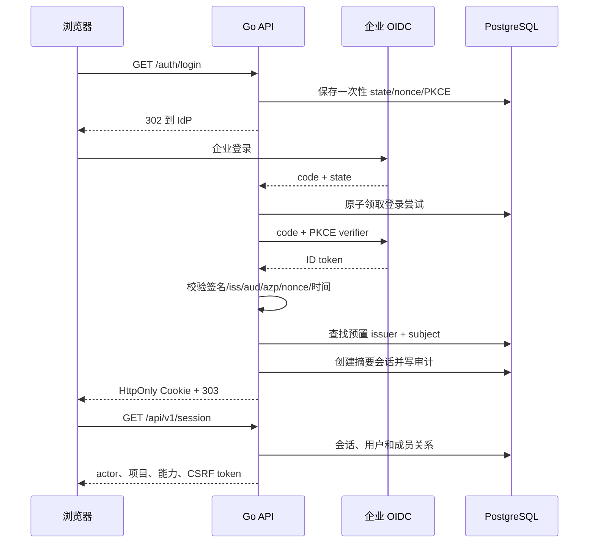

# P0 企业身份与项目访问基础设计

## 设计目标与边界

本切片把固定开发 actor/project 替换为标准 OIDC 登录、PostgreSQL 服务端会话和数据库内项目授权。身份层只决定“谁可访问哪个项目、能否创建草稿”；它不授予授权书、审批或目标执行能力。

浏览器不持有 OIDC token。PostgreSQL 是用户、外部身份、成员关系、会话和登录尝试的权威；Go API 完成 OIDC 协议与每请求授权；React 只展示服务端会话和能力。



## 身份与开通模型

- 外部身份主键为配置并经 discovery 核对的精确 issuer 与 OIDC `sub`。issuer 不做可能改变标识的隐式重写；email、姓名和展示名不是授权键。
- 采用管理员预置授权。受控 bootstrap CLI 先建立用户、外部身份、项目和成员关系；OIDC callback 只匹配，不自动建档或授权。
- 未预置、已禁用、issuer 不同或 subject 不同均拒绝创建会话。错误页面只显示稳定中文说明与 request_id，不回显 claims/token。
- 首版项目角色为 `viewer` 与 `analyst`。`viewer` 具有 `project:read`；`analyst` 额外具有 `task_draft:create`。命令回执仍要求原 actor，不能由 `project:read` 推导跨 actor 读取。
- bootstrap 是部署运维能力，不建立“首位登录者自动管理员”，也不等于后续执行权限。Web 成员管理界面、SCIM 和 claim 映射后置。

建议 CLI 形态：

```text
mousehole-admin provision-user \
  --issuer <精确 OIDC issuer> --subject <OIDC sub> \
  --user-id <UUID> --display-name <名称> \
  --project-id <UUID> --project-name <名称> \
  --role viewer|analyst
```

CLI 使用显式数据库连接，在一个事务中幂等创建或核对各对象并写管理审计。同一 `(issuer, subject)`、user ID、project ID 已存在但参数不一致时返回冲突，不覆盖原绑定。

## OIDC 协议合同

依赖锁定 `github.com/coreos/go-oidc/v3 v3.21.0` 与 `golang.org/x/oauth2 v0.37.0`，最终写入 `go.mod/go.sum`。API 使用 Authorization Code + PKCE S256，请求 `openid profile email`，不请求 `offline_access`，不保存 access/refresh/ID token。

`GET /api/v1/auth/login`：

1. 生成至少 256-bit state、浏览器绑定值、nonce 和 PKCE verifier；只允许固定安全 return path。
2. 数据库保存 state SHA-256、浏览器绑定 SHA-256、nonce SHA-256、加密的 PKCE verifier、return path、创建/过期时间；有效期默认 5 分钟。
3. 设置短期 HttpOnly、SameSite=Lax 登录绑定 Cookie，再返回 `302` 到发现文档提供的授权端点。数据库不保存 Cookie 原值。

`GET /api/v1/auth/callback`：

1. 对 state 与登录绑定 Cookie 做摘要后原子领取同一条未使用、未过期的登录尝试；缺失、错配或重复 callback 拒绝并清除登录 Cookie。
2. 使用 PKCE verifier 交换 code，要求存在 ID token。
3. 由 go-oidc 校验 issuer、签名、有效期及 client ID audience；项目另行比较 nonce。
4. 解析 `azp`：多 audience 时必须存在且等于配置 client ID；任何 token 只要携带 `azp`，其值都必须等于 client ID。
5. 只读取验证后的 `sub`、可选 email/name；匹配预置外部身份及活动用户后创建会话。
6. 成功设置 Cookie 并 `303` 到固定页面；失败不设置 Cookie，不把 token、code 或 claims 放入 URL/错误。

发现文档、JWKS 和 token exchange 使用有上限的 HTTP client。OIDC issuer、client ID、client secret、redirect URI 必须与配置精确一致；生产禁止跳过 issuer、TLS、client ID 或签名校验。

## 会话、Cookie 与 CSRF

会话原值由 256-bit 随机数生成，数据库只保存 SHA-256 摘要。默认绝对有效期 8 小时、空闲有效期 30 分钟，均可在受限范围内配置；每次请求读取 session、用户状态和撤销状态。`last_seen_at` 最多每 5 分钟更新一次，避免每个 GET 都写库。

生产 Cookie：`__Host-mousehole_session`、HttpOnly、Secure、SameSite=Lax、Path=/、无 Domain。开发 E2E 使用不同的显式开发 Cookie 名称，可在精确 loopback HTTP 下关闭 Secure；生产校验拒绝此例外。

`MOUSEHOLE_AUTH_KEY` 为 32-byte base64 主密钥。实现通过域分离派生登录尝试加密和 CSRF HMAC 子密钥；不把主密钥写入数据库、日志或配置样例。PKCE verifier 以 AES-GCM 加密后短期落库。

`GET /api/v1/session` 根据请求中的原始 session token 计算 `HMAC(csrf_key, "csrf:" + token)`，返回 CSRF token。浏览器只保存在 Query 内存缓存，不写 Web Storage。所有非安全方法要求单一 `X-CSRF-Token`，使用常量时间比较，并同时验证精确 Origin/Host。退出为 `POST /api/v1/auth/logout`，验证 CSRF 后撤销当前会话并清除 Cookie。

本切片不实现 OIDC back-channel logout、token introspection 或 IdP 禁用即时同步。平台本地禁用/撤销立即生效；IdP 侧变化最迟受会话绝对 TTL 限制，后续由 SCIM/back-channel 能力加强。

## 数据模型与迁移

新增 `00002_identity_access.sql`，不修改已发布的 `00001`：

| 表                    | 关键字段与约束                                                                        |
| --------------------- | ------------------------------------------------------------------------------------- |
| `users`               | `id`、display/email、`status=active                                                   | disabled`、时间；ID 稳定不复用 |
| `external_identities` | `issuer`、`subject` 唯一，关联 user；展示 claims 非授权依据                           |
| `projects`            | `id`、name、`status=active                                                            | disabled`、时间                |
| `project_memberships` | `(project_id,user_id)` 主键、role、state、version、撤销时间                           |
| `oidc_login_attempts` | state 摘要主键、浏览器绑定摘要、nonce 摘要、加密 verifier、return path、过期/消费时间 |
| `sessions`            | token 摘要主键、user、创建/空闲/绝对过期、last_seen、撤销时间                         |
| `access_audit_events` | actor/运维来源、对象、event、request_id、时间及安全摘要                               |

迁移为既有固定开发 actor/project 建立不可登录的历史 user/project，并把 membership 标记为 revoked/legacy，再为 `commands.actor_id/project_id` 和 `audit_events.actor_id` 增加外键。已有命令和审计原值不改写；新企业用户不能冒充历史 actor 查询旧回执。

登录尝试、过期 session 的物理清理后置为显式维护命令；逻辑过期不依赖清理任务。Down 会删除新身份数据和约束，只允许可丢弃开发库；生产回滚采用应用前向修复和备份恢复。

## 项目授权与命令事务

HTTP 认证中间件只负责解析 session 得到 `Principal{ActorID}`，不能成为项目授权的唯一检查。command 服务接收 actor，并在事务中执行：

1. 校验 UUID 与请求并开启 `READ COMMITTED` 事务。
2. `SELECT` 活动 user/project/membership `FOR SHARE`，确认所需 capability。
3. 保持成员行共享锁，执行现有命令唯一键、草稿、审计和 outbox 逻辑并提交。

成员撤销使用同一 membership 行的 `FOR UPDATE`/UPDATE。命令先持锁则完整提交后撤销；撤销先提交则命令看到 revoked 并拒绝。成员不物理删除，避免“无行可锁”的授权竞态。

命令 GET 同样在短事务中锁定活动成员并要求 `commands.actor_id == principal.actor_id`。找不到、属于其他 actor 或无项目访问时对外不泄露他人对象；同一稳定错误矩阵由 OpenAPI 定义。

## HTTP 与前端合同

OpenAPI 新增/调整：

- `GET /api/v1/auth/login`：浏览器导航，302。
- `GET /api/v1/auth/callback`：OIDC callback，成功 303，失败安全中文页面。
- `POST /api/v1/auth/logout`：Cookie + CSRF，204。
- `GET /api/v1/session`：返回 actor、显示资料、项目列表、角色、capabilities、CSRF token 和会话过期时间。
- 既有命令 PUT/GET：Cookie 认证；PUT 需要 CSRF；删除开发请求头。

公开错误增加 `unauthenticated`、`csrf_invalid`、`identity_not_provisioned`、`session_expired`，保持 `{code,message,request_id}`。callback 导航错误允许安全 HTML 表达，但必须复用稳定 code/request_id，禁止输出底层 exchange 或 claim 内容。

Web 首屏先查询 session：401 显示登录入口；成功后显示当前用户、项目选择和退出命令。项目选择只来自 session 响应，Query key 包含项目 ID；无项目时显示“尚未开通项目权限”。写请求从 session Query 取 CSRF token并携带 `credentials: include`，401/403 清除相应缓存，不自动重发 PUT。

## 配置与部署模式

配置区分：

- development：API 与 Web 仍只允许精确 loopback 地址，可连接进程拥有的合成 issuer；允许开发 Cookie 名称和 Secure=false。
- production：公共来源必须为 HTTPS，Cookie 强制 `__Host-`/Secure；OIDC issuer 必须 HTTPS；监听地址可由容器配置，但 Host/Origin 与公共 URL 精确匹配。反向代理转发头默认不作为授权依据。

新增配置包括公共 URL、Web URL、OIDC issuer/client ID/client secret、auth key、会话 TTL。样例只放占位符。API 启动做 discovery 并失败关闭；健康接口仍只表示进程存活，未来 readiness 另建。

## 验证策略

- 单元：配置、cookie、state/nonce/azp、PKCE、CSRF、claim 解析、错误映射、capability 映射。
- PostgreSQL 集成：迁移保留、bootstrap 幂等/冲突、session 摘要、用户禁用、成员撤销、并发锁顺序、跨 actor 回执拒绝。
- HTTP 集成：进程内合成 issuer 完成 discovery/JWKS/token exchange，覆盖签名轮换和所有无效 claim。
- Web：session schema、登录/无权限/过期状态、项目切换、CSRF、既有未知结果恢复。
- Playwright：真实浏览器经合成 issuer 登录，刷新恢复、创建/查询、撤销、退出；断言 URL/Web Storage/页面不含 token。
- 回归：既有命令并发、回滚、全进程重启和生成漂移继续通过。

## 风险、兼容与回滚

- OIDC 供应商差异：本切片只承诺标准 discovery/code/PKCE；生产 IdP 联调单独验收。
- IdP 禁用传播：无 SCIM/back-channel 时不是即时，依靠本地撤销与 8 小时上限；文档不得声称 IdP 侧即时下线。
- 迁移：先扩展身份表并保留历史固定 ID，再切应用；不删除旧命令。应用回滚不能恢复已撤销会话，属于安全方向的不可逆变化。
- auth key 丢失会使登录尝试和 CSRF 失效，但数据库会话原值本就不可恢复；轮换需主动撤销会话并重新登录，本切片不实现无感多密钥轮换。
