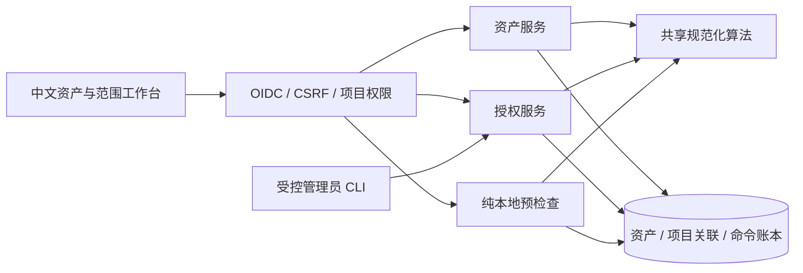

# P0 授权版本、资产规范化与策略预检查设计

本文为用户于 2026-10-12 批准的实施设计，交付状态以实际验收记录为准。继承 [总体设计](../../../10-11-artex-rebuild-plan/design.md)、[中文编码规范](../../../10-11-artex-rebuild-plan/coding-standards.md) 和既有 OIDC/草稿命令合同；源码依据见 [ARTEX 范围与复用研究](research/artex-scope-and-reuse.md)，调研时的备选项由本文收敛。

## 1. 切片边界与数据流

技术栈沿用 Go、PostgreSQL、pgx/sqlc/goose，以及 React/TypeScript/Vite、Tailwind/shadcn、TanStack Query、React Hook Form/Zod。当前版本以 `scripts/toolchain.json`、`backend/go.mod`、`web/package.json` 和 lockfile 为准。需要域名解析算法时引入并锁定 `golang.org/x/net/idna` 与 `publicsuffix`，仅使用本地算法和内置后缀表。Web 列表采用服务端分页；本切片无需图数据库、Redis、Temporal 或 Runner。

预检查不查询目标 DNS，不发 TCP/HTTP，不调用模型，不签发执行凭证。它说明静态输入和当前规则是否匹配，以及未来运行时仍须检查什么；不以 HTTP 方法或名称推定真实操作非破坏性。

## 2. 模块与兼容边界

| 模块                     | 权威职责                                        | 依赖与限制                                                |
| ------------------------ | ----------------------------------------------- | --------------------------------------------------------- |
| `internal/target`        | 域名、IP、CIDR、URL 规范化及结构化相等/包含判断 | 纯函数；禁止 resolver/client/进程调用                     |
| `internal/access`        | 同事务锁定活动用户、项目、成员并检查能力        | 使用 sqlc/pgx；草稿与新领域服务共用，避免各自复制权限判断 |
| `internal/asset`         | canonical asset、项目关联、来源声明、导入       | 来源不是验证过的 Observation；不改变授权                  |
| `internal/authorization` | 不可变内容版本、激活指针、撤销、当前 deny       | 管理状态与版本内容分开；不执行外部动作                    |
| `internal/policy`        | 固定预检查目录、静态匹配与解释                  | 由服务端裁定等级；不充当完整 admission                    |
| `internal/scopecommand`  | 新领域幂等账本、回执及审计/outbox               | 仅抽取新切片共享流程，不重构旧草稿的回执/表结构           |

`00001` 的 `commands.kind`、审计/outbox 类型及非空 `task_id` 已被 SQL 约束绑定草稿。新增 `scope_commands`、`scope_audit_events`、`scope_outbox_events`，不把资产或授权伪装成任务草稿。旧 `/commands` 和四类记录不变；唯一必要的兼容修复是把旧服务的权限入口切换到完整锁定 helper。

现有数据库 spec 对“锁定 user/project/membership”的描述比实现更强：`backend/db/queries/identity.sql:127` 的查询仅 `FOR SHARE OF pm`。实施时修复行为、补实际并发测试，再更新 spec；不能把规划内容提前写成已实现规则。

## 3. 规范化与匹配合同

所有资产导入、范围保存和预检查都调用同一 Go 算法；Web 只做输入提示，以服务端结果为准。算法版本固定为 `target-v1`，升级不能静默改写已有 canonical value 或授权内容。原始输入限制长度、拒绝控制字符，任何拒绝都返回字段路径和中文原因。相等判断使用 `(kind, canonical_value)`，不得仅依赖 hash。

| 类型 | 规范化                                                                                                                              | 拒绝与匹配边界                                                                                                                                                                                                                       |
| ---- | ----------------------------------------------------------------------------------------------------------------------------------- | ------------------------------------------------------------------------------------------------------------------------------------------------------------------------------------------------------------------------------------ |
| 域名 | 严格 IDNA 非 transitional、ASCII 小写；最多一个尾点去除；校验 label 与总长                                                          | 拒绝 URL、端口、空 label、通配符、控制字符及 IP 字面量。允许企业内部域名；启用 `include_subdomains` 时拒绝已知 ICANN/私人公共后缀。匹配仅 `host == domain` 或 `host` 以 `.` + `domain` 结束；不以 eTLD+1 自动扩大范围                |
| IP   | `netip.ParseAddr`，IPv4-mapped IPv6 用 `Unmap`，输出标准字符串                                                                      | 拒绝 zone、整数/八进制/缩写 IPv4、混合歧义表示。IP 与域名是不同资产类型                                                                                                                                                              |
| CIDR | `netip.ParsePrefix`，标准 family/字符串                                                                                             | 只用于范围；拒绝 IPv4-mapped prefix。含主机位时返回错误和 masked 建议，不自动扩大；用户确认后重新提交规范 CIDR                                                                                                                       |
| URL  | 仅 HTTP/HTTPS；scheme 小写，host 使用域名/IP 算法，IPv6 加方括号；移除默认端口，空 path 变 `/`；仅 path 的 percent 十六进制统一大写 | 拒绝 userinfo、fragment、zone、反斜杠、不合法 percent、点段及编码的 slash/backslash/点段歧义。保持 path 大小写、重复 slash 和 query 原始字节（含 percent 大小写/顺序）；不解码保留字符，不排序 query；保留空 query 与无 query 的区别 |

URL exact 匹配使用 `scheme + canonical_host + effective_port + canonical_escaped_path + raw_query + force_query`；`%41` 与 `A` 可保守视为不同，`/a` 与 `/a/` 不相等。URL 不能通过 path/query 子串或前缀获得许可；任意多重编码最终语义及实际重定向由后续可信适配器复核。保存 URL 的查询参数视为受项目权限保护的目标数据，不进入日志、URL 筛选或浏览器持久化存储；导入工具不能把凭据当作目标参数。

首版只支持四种结构化范围：`domain`、`ip`、`cidr`、`url_exact`。不提供正则、关键词、URL 前缀、自由表达式。可显式授权私网；禁止 loopback、link-local、metadata、multicast、unspecified 以及平台管理地址。硬拒绝规则覆盖 IPv4、IPv6 和 mapped 表示，采用有编号的内置地址表；部署的额外管理 CIDR/域名存入当前 deny，而非不留版本的隐式环境判断。

## 4. 资产和来源

全企业 `assets` 去重，`project_assets` 显式授予项目可见性；HTTP 只从项目关联入口查询，不提供全局资产探测入口。同一 canonical asset 被两个项目导入时，客户端得到本项目关联和来源，不得到另一项目名称、来源、导入人或“全局已存在”的标记。内部资产 UUID 不作为权限凭证。

导入命令 payload 为 1–100 个条目，类型为 domain/ip/url，单条 URL 最长 2048 字节，总请求不超过 256 KiB；来源为 `manual` 或 `api_import`，附受限中文备注/外部引用，无抓取行为。服务端返回规范值预览与本批重复/项目已有统计；正式导入同事务提交全部有效条目，任一无效条目整批不受理。预览不入资产表；前端显示行号并保留输入，不暗中跳过错误行。

同批先规范化去重，再按类型/规范值稳定排序 upsert，减少并发锁反转。来源声明与 command 关联，同 command 重放不新增来源；新 command 的再次导入可新增来源，仍只有一个项目资产关联。不保存未受限原始行，不将来源升级为“已验证”。资产状态、移除关联、外部同步和服务/端点观测后置。

## 5. 授权内容与生效状态

每个项目一个稳定 `authorization_letter`，具有递增版本；新版本保存后内容不可编辑。界面“修改”复制旧内容，生成新候选版本。保存时生成 version ID、递增序号、规范内容和 SHA-256；数据库触发器阻止版本正文/范围条目 UPDATE/DELETE，运行账号按部署约束不得绕过。该机制不宣称能抵御数据库超级管理员，外部 WORM 锚点后置。

内容包括：标题、授权依据引用、联系人、`valid_from/expires_at`、`target-v1`、`policy_version/catalog_version`、结构化范围及各条 operation/port/解析网络约束、操作等级上限、请求/并发/速率硬预算、重定向禁止、凭据禁止。规则包固定 `policy-v1`、目录固定 `precheck-v1`；未知版本拒绝。时间使用 UTC RFC3339，`valid_from < expires_at`，有效区间为 `[valid_from, expires_at)`。首版固定 `redirect_policy=deny`、`credential_policy=none`；超出首版能力的值拒绝。正文不得包含凭据或上传的授权书文件；依据引用为人工确认信息，不代表平台已验证法律效力。

版本表单限制：标题 1–120 个 Unicode code point、依据引用/联系人分别最多 500/200、范围 1–100 条、每条最多 32 个端口和 32 个解析 CIDR；未知字段拒绝。预算使用有单位的正整数 `max_requests/max_concurrency/max_requests_per_second`，max_concurrency 不得超过 max_requests；本切片只保存/解释上限，不计算预算是否已消耗。规范内容编码由服务端固定字段顺序与排序集合生成，hash 不包含 actor、created_at、version/entry 数据库 ID 或可变状态；相同语义内容可有相同 hash，但版本身份始终独立。

范围条目：`entry_id/kind/value/include_subdomains/operations/ports/resolved_ip_cidrs`。`include_subdomains` 只对 domain 有效；TCP/HTTP 端口显式列举 1–65535、不采用任意端口默认值。以域名连接 TCP 或 URL 域名进行 HTTP 时，必须在同条目显式声明允许的解析 CIDR；DNS-only 条目可为空。DNS 名称许可不授权对共享 IP 的任意直接访问；直接 IP 目标必须匹配 IP/CIDR/精确 IP URL 条目。多条范围不能拼接成一个完整授权：至少一条同时匹配 operation、目标、端口和解析约束。范围和集合稳定排序后 hash，全部语义字段都纳入，包括时窗、上限和规则版本。

| 存储状态     | 可发生的管理转换 | 预检查意义                                 |
| ------------ | ---------------- | ------------------------------------------ |
| `candidate`  | 激活或撤销       | 尚未生效，拒绝                             |
| `active`     | 被替代或撤销     | 同时满足当前指针、时窗及规则才继续静态检查 |
| `superseded` | 可进一步撤销     | 只读历史；不能重新激活                     |
| `revoked`    | 无               | 只读历史；永久拒绝                         |

`expired` 是由权威检查时刻计算的展示状态，不依赖后台 timer 改写正文。激活只允许当前有效期内的 candidate，旧 active 同事务变 superseded；未来时窗候选到时再显式激活，过期不自动恢复任何历史版本。首次激活或替代必须附 `expected_policy_revision`；当前指针/撤销/deny 修改递增 revision，冲突返回 409、不覆盖。创建 candidate 锁 letter 分配序号，但不改变当前 policy revision；重复条目规范化去重后保存，不拼接权限。

撤销当前版本清空 active 指针；撤销历史版本仍保留内容与审计。父方案未来固定旧 Run 的规则明确为：固定版本用于复核，已 superseded/revoked 的版本不能获得新动作许可，需用新版本重新计划。当前 deny 始终叠加，不允许固定旧版本绕过；实际停止传播和 Runner 确认属于 P1。

## 6. 当前紧急禁止

全企业稳定 `global_policy_state` 单行和每项目 `project_policy_state` 持有递增 revision；`scope_denies` 保存结构化 domain/ip/cidr/url_exact 规则、原因、作用域与 active 状态。管理 CLI 可新增/撤销 deny，修改条件用新规则替代；保留历史与每次状态变更的审计。deny 的域名及 URL 同样使用规范化算法。禁止规则优先于授权，不允许 analyst 修改、绕过或使用预检查结果取消禁止。

IP/CIDR deny 可用于已知 IP 目标；域名尚未解析时列入未来 final-IP 必检，不能因静态未命中而声称解析地址获准。含解析 CIDR 的授权若仅部分与 deny 相交，不伪装整个 CIDR 已获准；后续每个实际 IP 都须检查。管理员可撤销显式 deny，内置平台保留地址硬拒绝不可由普通授权/deny 撤销放宽。

## 7. 权限、事务及锁顺序

viewer 可读自己项目的资产、授权版本、当前 deny 和预检查历史；analyst 另可导入资产、创建 candidate、发起预检查。两者不能从 Web 激活/撤销或更改 deny；复用受控管理员 CLI，不新增 Web 管理角色。命令回执仅原 Web actor 可查询；预检查历史可由当前项目 viewer 阅读，跨 actor 不能探测幂等键。

CLI 通过部署权限执行，明确 `operator_source=admin_cli`、`actor_id=null`、操作引用；人填的备注/引用不作为 OIDC 已验证身份。CLI 输出不包含 DSN/秘密；文件 payload 可接收规范授权内容，不引入伪造用户 ID。全局 deny CLI 不通过项目 Web 接口公开。

所有事务遵守：活动 user 行 → project 行 → membership 行 → global policy state → project policy state/letter → command → 版本/业务对象。同层多对象按 UUID 或 canonical key 稳定排序。用户、项目、成员的 Web 权限检查分别用 `FOR SHARE` 并重验状态；不能只 JOIN 后锁 pm。管理员用户禁用用 user `FOR UPDATE`；成员撤销先 share user/project 再 update membership；未来项目禁用必须 update project 并遵守同序，不在此切片新增项目禁用 UI。

预检查对 global/project state 取共享锁；全局 deny 变更对 global 取排他锁，项目激活/撤销/deny 对 global 取共享锁、project state 取排他锁。migration 回填每个项目的 policy state，provision 创建新项目时同事务补齐；缺少稳定 state 行返回依赖失败，不能把“无行”当无限制。无 deny 可锁时仍锁 state，避免 phantom 规则竞态。

采用 READ COMMITTED，拿齐锁后用一次 `clock_timestamp()` 作为 `checked_at`，读取当前规则完成本地判断，再写 ledger/decision/audit/outbox 并提交。激活/撤销/deny/用户禁用先提交，则后续预检查使用新状态；预检查先拿锁，则其结果标明旧 revision 和 checked_at，管理命令等待它提交。历史结果永不改写，也不证明查询时仍有效。临近到期时仍不得将历史结果用于未来执行。长事务内禁止目标/模型/外部 I/O。

## 8. 新命令账本与未知结果

新增 kind：`import_assets`、`create_authorization_version`、`precheck_target`、`activate_authorization_version`、`revoke_authorization_version`、`add_scope_deny`、`revoke_scope_deny`。Web 使用稳定 UUID command_id；CLI 同样要求显式 command_id 和结果查询。`scope_command_namespaces` 建立 project/global 两种命名空间：项目外键唯一，全局只有一行，migration/provision 分别建立；`scope_commands` 以 `(namespace_id, command_id)` 唯一。namespace 使用独立 UUID，不拿 project UUID 与固定 global UUID 混用，也不用 nullable 唯一键。

记录 principal/source、kind、规范 payload/hash、accepted_at、结果引用与冻结回执；hash 之外仍核对规范 payload。namespace + ID 在新切片各 kind 间共享，异 kind/actor/参数不能覆盖。对当前权限先检查，再查询同键：同 actor/同参数返回原结果；其他 actor 返回不暴露内容的 404，异参数返回 409。仅首次受理后检查 expected revision 和业务状态，不能因重放携带旧 revision 而拒绝原成功回执。CLI replay 核对 source 和操作引用，不把旧 revision 的已成功命令再次执行。

新命令受理、业务写入/deny 决策、追加审计及 outbox 在同一事务；任何必需写入失败整体回滚。`deny` 是成功持久化的策略业务结论，不用 403 代替；权限/输入拒绝在受理前返回，不产生资产或授权，常规请求日志只保留安全元数据。outbox 此时无 dispatcher/SSE，不声称已投递或驱动执行。审计记录 actor/source、对象引用、revision、hash、原因码及数量，不写原始 URL/query、联系人或整份 payload。

前端/CLI 在提交前确定 ID；5xx、断线、超时、schema 不符为结果未知，只用原 ID 查询。404 表示暂未确认受理，可继续查询或显式以原 ID/原参数重试；不能自动换 ID。响应重放保留原 checked_at 和版本，不重新检查并覆写原 decision；用户可用新 command 显式重新检查。

## 9. 预检查目录与决策

预检查固定目录 `precheck-v1` 为：`dns_lookup`（domain，固定 A/AAAA）、`tcp_connect`（domain/IP，显式 port）、`http_metadata`（URL，固定 HEAD、禁止 body/credential/redirect）。未知 operation、额外参数、超首版等级均拒绝；目录只是静态语义输入，不是经过执行审核的 ToolCapability。未来适配器须重新确认非破坏性和协议语义。

请求含 `command_id` 路径、`authorization_version_id/operation/target/parameters`；不要求资产先入库，不将资产存在与否作为允许依据。服务端依次检查目录/参数、规范化、全局/项目/平台 deny、当前有效版本、操作上限、完整范围匹配、已声明约束。遇到结构非法返回 400；可解释的有效请求通过命令受理并返回以下结论：

| 结论                      | 中文展示                       | 数据                                                               |
| ------------------------- | ------------------------------ | ------------------------------------------------------------------ |
| `deny`                    | 静态规则拒绝                   | 稳定 reason_codes、字段/条目引用、checked_at 与规则 revision       |
| `requires_runtime_checks` | 静态规则匹配，执行条件尚未验证 | 同上及 matched_entry_id、逐项 runtime_checks；无 token/lease/allow |

原因包括版本未激活/过期/被替代/撤销、目标不匹配、端口/操作不匹配、紧急禁止、平台地址、目录不支持。未知对象在已授权项目内返回统一 404，不泄露其他项目授权内容。decision 保存规范目标、输入 hash、version/content hash、policy/catalog/algorithm 版本、全局/项目 revision、时间、匹配条目、原因和待检项；无原始工具输出。

runtime_checks 至少列实际 DNS/CNAME 链、每个 final IP/IPv6、解析 CIDR/当前 deny、连接/重定向策略、可信适配器语义、当前授权/成员权限、lease/fencing/TTL、真实速率/预算/时窗和执行审计可用性。按 operation 标注 required/not_applicable；TCP/HTTP 必需项不能被“静态匹配”消除。保存预算只表达上限，本切片不实现消耗账本或连接限流。

## 10. 数据模型与 migration

新增 `00003_authorization_assets.sql`，不改已发布 `00001/00002`。关键表：

| 表组                                                                                                    | 关键约束                                                                                                                                   |
| ------------------------------------------------------------------------------------------------------- | ------------------------------------------------------------------------------------------------------------------------------------------ |
| `assets/project_assets/asset_import_sources`                                                            | 类型+canonical unique；项目资产组合 FK；来源绑定 command，重放不重复                                                                       |
| `authorization_letters/authorization_versions/authorization_version_states/authorization_scope_entries` | 项目版本序号唯一；正文与状态分离；entry 所属版本 FK；单项目 active 指针/状态一致，事务及延迟约束验证；内容不可变触发器                     |
| `global_policy_state/project_policy_state/scope_denies`                                                 | 全局 singleton；项目 policy 行 FK；revision BIGINT；全局或项目作用域 CHECK                                                                 |
| `scope_command_namespaces/scope_commands/scope_audit_events/scope_outbox_events/policy_prechecks`       | namespace 类型/项目约束及全局唯一；namespace+command unique；业务结果关联；审计/outbox 追加；decision 与项目/授权同属 FK，防跨项目 ID 关联 |

序号/revision/计数采用 BIGINT，API 十进制字符串，不转 JS number。时间 TIMESTAMPTZ、输出 UTC；种类、状态、结果枚举与时窗/预算有 CHECK。项目内关联用组合 FK，不仅依赖 service 校验。audit/outbox 不含可执行任务或调度行为。响应、索引与 SQL 查询按实际字段设计生成，不使用通用 EAV 或自由 SQL。

迁移前备份并检查旧命令历史；先运行 migration，再部署新 API/admin。旧 API 可读旧草稿；新表回滚优先关闭新入口并前向修复。Down 删除新增历史，只用于明确可丢弃的随机测试 schema；不能通过删卷恢复测试。独立迁移账号与运行账号仍按总体部署合同，当前本地 compose 的共享开发账号不冒充生产权限隔离。

## 11. HTTP、错误与列表

Web 继承 Cookie/CSRF，无 API token 新认证模式；“API 导入”仍是带项目权限的同源接口。新资源入口：

| 接口                                                | 行为                                                  |
| --------------------------------------------------- | ----------------------------------------------------- |
| `GET /api/v1/projects/{project_id}/assets`          | 类型/规范值服务端筛选与 seek 分页                     |
| `POST .../assets/preview`                           | 仅规范化与批次错误预览，受保护/CSRF，不落库           |
| `PUT .../scope-commands/{command_id}`               | 固定 discriminated payload；导入/candidate/预检查受理 |
| `GET .../scope-commands/{command_id}`               | 原 actor 回执恢复                                     |
| `GET .../authorization-versions` 与 `/{version_id}` | 项目候选/历史分页与完整只读内容                       |
| `GET .../policy`                                    | 当前 active/revision/项目及有效全局 deny 的安全视图   |
| `GET .../prechecks` 与 `/{decision_id}`             | 项目决策历史及解释；权限重验                          |

CLI 管理不新增 HTTP 管理入口；新增 `admin scope ... --command-id ...` 和 `admin scope-command get ...`，精确参数在实现 CLI 时同步 README。所有接口先用同事务权限过滤，再查对象；响应不得回传其他项目的记录或原始 SQL 错误。OpenAPI 3.1 描述中文，机器字段英文，Ajv 运行时验证响应和请求对象匹配。

列表 page_size 默认 25、最多 100，稳定 `(created_at,id)` seek 排序；cursor 绑定项目/筛选/排序和可校验结构，篡改/不匹配返回 400。无需跨页快照或精确 total；返回 `has_more/next_cursor`、本页数量并明确显示未给总量。新插入不会挤乱后续旧记录，用户刷新首屏看到更新。搜索参数最长 200 字符，参数化 SQL并转义 LIKE 特殊字符。URL 筛选只保存项目/类型等非敏感字段，目标搜索值保留内存，不进入地址栏。

错误使用现有 envelope 与 request_id：400 invalid_request、401 unauthenticated、403 forbidden/csrf_invalid、404 not_found、409 command_conflict/policy_revision_conflict、503 unavailable。新增码必须与状态一一校验并有中文消息；预检查的 deny 为 200/201 业务结果。502/未知码/schema 错误不能显示已明确失败。

## 12. 中文工作台与恢复

在既有项目选择和草稿入口旁增加“资产”“授权范围”“策略预检查”。拆分 features，不把整个切片继续写入 App。需要深链接和列表返回时采用 React Router，精确版本经兼容检查后锁定；本切片不为小型表格额外引入第二套状态库。

资产页支持多行导入、服务端规范化预览、行号错误、数量与重复说明、来源可查；范围页支持候选表单、只读规范内容、有效期/当前版本/revision/禁止规则、复制生成新版本。管理员动作显示 CLI 操作说明与所需版本，不给 analyst 可点击的假管理按钮。预检查页以中文解释匹配条目、拒绝理由、检查时刻/规则版本和运行时缺项，避免绿色“允许执行”提示。

TanStack Query key 含 actor/project/filter/cursor/object；session/project 改变时取消所有项目请求并清除旧草稿及新领域缓存/表单/unknown。受理时同步锁定 command ID 与 payload，查询恢复不得重发。candidate 冲突/输入失败保留编辑内容；恢复重放后显示原结果时间，重新检查使用新 ID。服务端状态只存在 Query，敏感目标与原始输入不持久化浏览器。

loading/empty/error/stale/unknown、提交中/已受理/静态拒绝分开显示。提供键盘访问、表单 label、错误关联、aria-live、可见焦点、列表/详情返回位置及窄屏路径。新增 shadcn 控件保留许可证与 provenance；业务说明/TSDoc 中文，不复制 ARTEX 页面或暗中执行 URL。目标/来源备注都作为文本渲染。

## 13. 后续执行必须补齐的合同

Action admission、审批绑定、真实 ToolCapability、Temporal、lease/fencing、执行预算、Runner/egress、DNS rebinding/CNAME/redirect、实际停止确认、证据和报告仍属后续切片。P1 必须重新校验当前规则并证明每次实际目标连接受控，不能消费本切片历史预检查作为许可。保持父需求 R1/R2/R6/R7/R9/R13 与 A1/A6/A9/A11/A12 的部分映射，不宣称父验收完整通过。

## 14. 实施收敛与验证

实际新增 00004_scope_integrity.sql 前向补强 namespace、预算与授权条目/正文集合完整性；已存在 namespace 保护时校验 trigger 函数、事件和启用状态后兼容升级，保留历史，不改goose 迁移状态或删除约束。完整用户/项目/成员锁已由新旧服务共享。HTTP 400 的受控 validation_errors 经 OpenAPI/Ajv 和中文表单定位，不公开原 payload/SQL。新旧 unknown Hook 均由项目路由祖先持有，敏感搜索以 location.key 在内存恢复。完整 PG、Web56测试、真实12 E2E与重启均已通过，证据见根目录 docs/validation/p0-authorization-assets.md。用户选定的 shadcn-admin 底座是下一独立整合，当前未换框架。
